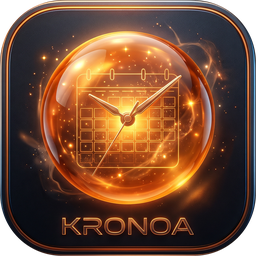
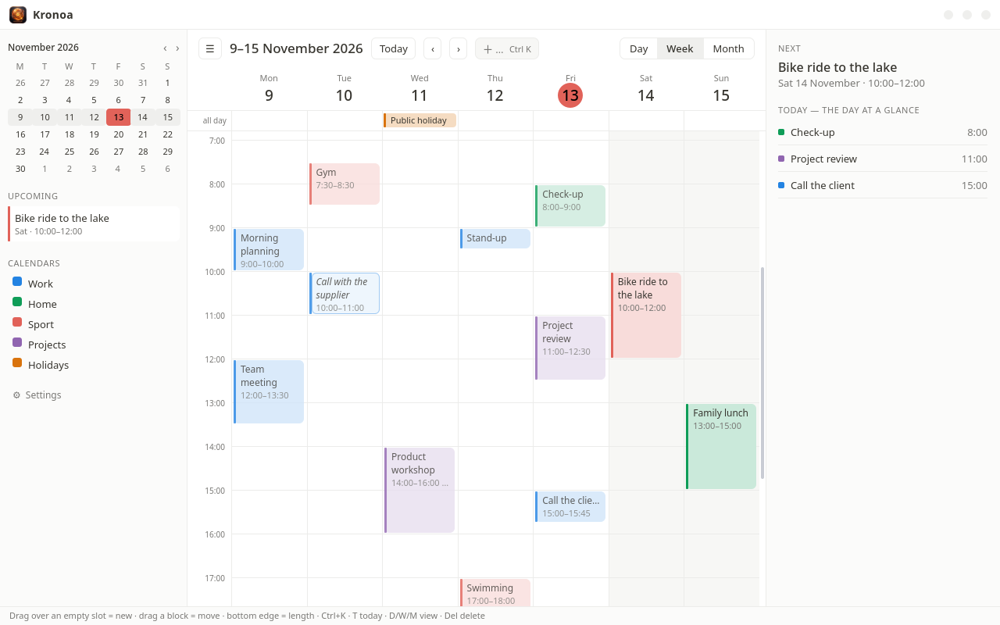
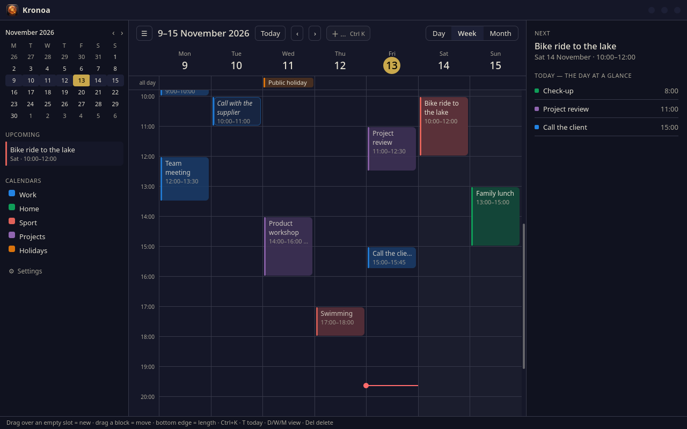
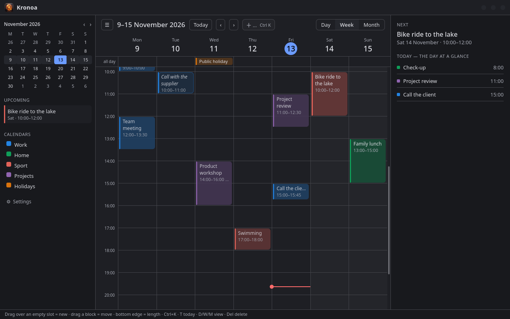
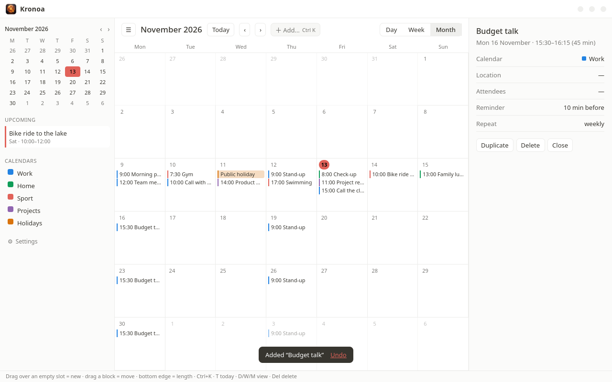
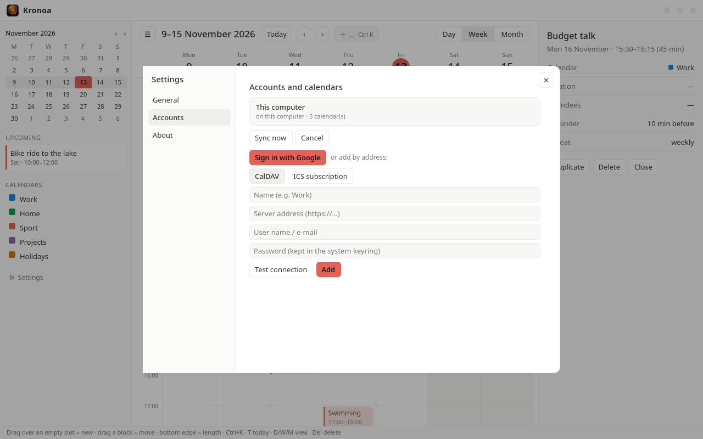

<div align="center">



# Kronoa

**A fast, native desktop calendar for Linux.**
Rust engine · Qt 6 / QML interface · English and Polish

[](https://github.com/longer54/kronoa/releases)
[](#license)

[Features](#features) · [Screenshots](#screenshots) · [Install](#install) · [Build from source](#build-from-source) · [Google Calendar](#google-calendar) · [Configuration](#configuration) · [Polski](README.pl.md)

</div>

Kronoa is an open-source desktop calendar. The engine (`kronoa-core`) is written in Rust and the
interface is Qt Quick bound through cxx-qt, so it is not a browser shell: it starts quickly and
stays light on memory. It keeps local calendars and syncs with Google Calendar, CalDAV servers and
ICS subscriptions.

## Features

- **Day, week and month views**, with a mini calendar, an "Upcoming" list and a "today at a glance" panel.
- **Drag and resize.** Drag over an empty slot to create an event, drag a block to move it, drag
  its bottom edge to change the length.
- **Command palette (Ctrl+K)** and **quick add** in English and Polish: type
  `meeting tomorrow 2pm 1h weekly` and the event is created.
- **Undo (Ctrl+Z)** for create, move, edit and delete.
- **Google Calendar, two-way.** Sign in with OAuth 2.0 + PKCE; every Google calendar appears with
  its colour, events are read incrementally and created, edited and deleted from Kronoa, including
  all-day events, recurring series and time zones. See [Google Calendar](#google-calendar).
- **CalDAV accounts** and **ICS subscriptions**, next to local calendars.
- **Themes:** light, dark, navy, or follow the system.
- **Reminders** with desktop notifications and a **tray icon**.
- **Local and private.** Passwords and the Google refresh token go to the system keyring; there is
  no telemetry and no account with us.

Keys: `Ctrl+K` quick add / palette, `T` today, `D` / `W` / `M` day / week / month, `Del` delete,
`Ctrl+Z` undo.

## Screenshots

| Week, light | Week, navy |
|---|---|
|  |  |
| **Week, dark** | **Month** |
|  |  |



The screenshots show demo data.

## Install

Download `kronoa-<version>-linux-x86_64.tar.gz` from [Releases](https://github.com/longer54/kronoa/releases), then:

```sh
tar xzf kronoa-0.1.0-linux-x86_64.tar.gz
cd kronoa-0.1.0-linux-x86_64
./scripts/install-user.sh ./kronoa
```

The script installs for your user only, without root: the program to `~/.local/bin/kronoa`, icons
to `~/.local/share/icons` and a launcher entry to `~/.local/share/applications`
(`PREFIX=/some/dir` changes the prefix). It needs **Qt 6** (Base, Declarative/Quick,
QuickControls2, Widgets) from your distribution.

## Build from source

You need a Rust toolchain and Qt 6 (Quick, QuickControls2, Widgets) with development files.

```sh
git clone https://github.com/longer54/kronoa && cd kronoa
cargo build --release -p kronoa
scripts/install-user.sh          # binary, icons and .desktop into ~/.local
```

Screenshot test (headless): `QT_QPA_PLATFORM=offscreen kronoa --autotest=DIR`.

## Google Calendar
Settings → Accounts → Add account → **Sign in with Google**. Every Google calendar appears as its own
calendar (with its colour and a checkbox); events are read incrementally (sync tokens) and
created / edited / deleted from Kronoa, including all-day events, recurring series and time zones.
Google requires each app to use an OAuth client, so create your own (free, ~5 minutes):

1. <https://console.cloud.google.com> → create a project → *APIs & Services* → *Library* → enable **Google Calendar API**.
2. *OAuth consent screen*: user type External, add yourself under *Test users* (or publish the app).
3. *Credentials* → *Create credentials* → *OAuth client ID* → application type **Desktop app**.
4. Put the client id and secret into `~/.config/kronoa/config.toml`:

        [google]
        client_id = "123-abc.apps.googleusercontent.com"
        client_secret = "GOCSPX-..."

   (or set `KRONOA_GOOGLE_CLIENT_ID` / `KRONOA_GOOGLE_CLIENT_SECRET`). Never commit these.
5. Click the button; the browser opens, sign in and allow access. Kronoa listens once on
   `http://127.0.0.1:<random port>` (PKCE), stores the refresh token in the keyring and refreshes access automatically.
   *Disconnect* revokes it. Apps in "Testing" mode get refresh tokens that expire after 7 days - publish the app to avoid that.

## Configuration

Settings are edited in the app (*Settings*) and stored in `~/.config/kronoa/config.toml`.
`config.example.toml` lists every option:

```toml
language = "auto"        # auto | en | pl
week_start = "monday"
time_format = "24h"      # 24h | 12h | system
default_view = "week"
default_reminder = 10    # minutes
sync_interval = 15       # minutes
```

Environment: `KRONOA_LANG` (`en` / `pl`), `KRONOA_GOOGLE_CLIENT_ID`, `KRONOA_GOOGLE_CLIENT_SECRET`.

## License

MIT OR Apache-2.0.
