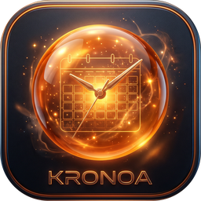
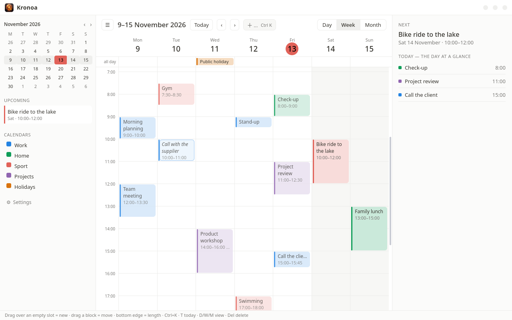
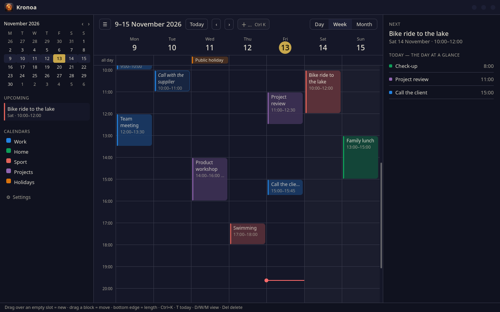
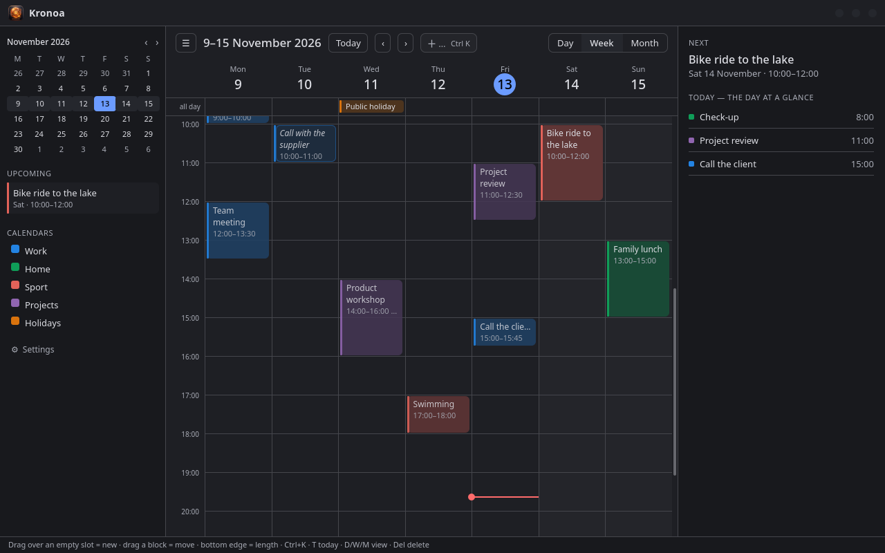
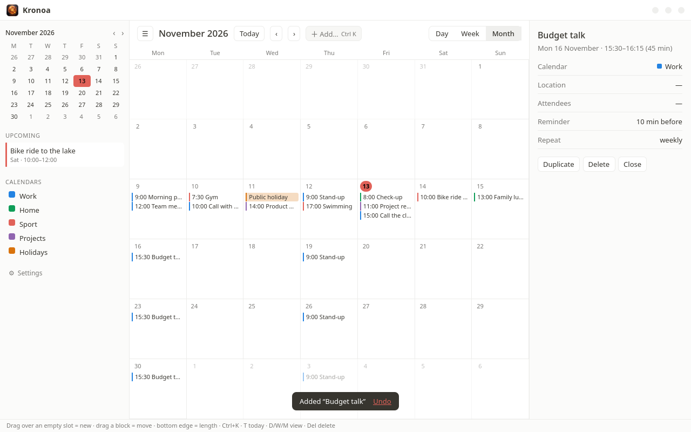
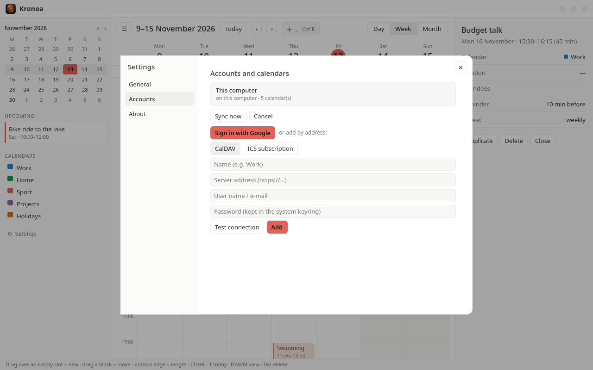

<div align="center">



# Kronoa

**Szybki, natywny kalendarz na pulpit Linuksa.**
Silnik w Ruście · interfejs Qt 6 / QML · po polsku i angielsku

[](https://github.com/longer54/kronoa/releases)
[](#licencja)

[Funkcje](#funkcje) · [Zrzuty ekranu](#zrzuty-ekranu) · [Instalacja](#instalacja) · [Budowanie ze źródeł](#budowanie-ze-źródeł) · [Google Calendar](#google-calendar) · [Konfiguracja](#konfiguracja) · [English](README.md)

</div>

Kronoa to otwartoźródłowy kalendarz na pulpit. Silnik (`kronoa-core`) jest napisany w Ruście,
a interfejs to Qt Quick podpięty przez cxx-qt — to nie jest powłoka przeglądarkowa, więc startuje
szybko i mało waży. Trzyma kalendarze lokalne i synchronizuje się z Google Calendar, serwerami
CalDAV i subskrypcjami ICS.

## Funkcje

- **Widoki dnia, tygodnia i miesiąca**, z mini-kalendarzem, listą „Nadchodzące” i panelem „dzisiaj w skrócie”.
- **Przeciąganie i zmiana długości.** Przeciągnij po pustym polu, by dodać wydarzenie; przeciągnij
  blok, by je przenieść; dolna krawędź zmienia długość. Nowe wydarzenie to szkic: Enter zapisuje, Esc anuluje.
- **Edycja daty i godzin** w panelu wydarzenia (zmiana początku zachowuje długość).
- **Paleta poleceń (Ctrl+K)** i **szybkie dodawanie** po polsku i angielsku:
  wpisz `spotkanie jutro 14:00 1h co tydzień`, a wydarzenie powstanie.
- **Cofanie (Ctrl+Z)** dodania, przeniesienia, edycji i usunięcia.
- **Google Calendar w obie strony.** Logowanie OAuth 2.0 + PKCE; każdy kalendarz Google pojawia się
  z kolorem, wydarzenia są pobierane przyrostowo i tworzone, edytowane i usuwane z Kronoi, także
  całodniowe, cykliczne i ze strefami czasowymi. Zobacz [Google Calendar](#google-calendar).
- **Konta CalDAV** i **subskrypcje ICS** obok kalendarzy lokalnych.
- **Motywy:** jasny, ciemny, granatowy albo zgodny z systemem.
- **Przypomnienia** z powiadomieniami pulpitu i **ikona w zasobniku**.
- **Lokalnie i prywatnie.** Hasła i token odświeżania Google trafiają do systemowego keyringu;
  bez telemetrii i bez konta u nas.

Skróty: `Ctrl+K` dodawanie / paleta, `T` dziś, `D` / `W` / `M` dzień / tydzień / miesiąc,
`Del` usuń, `Ctrl+Z` cofnij.

## Zrzuty ekranu

| Tydzień, jasny | Tydzień, granatowy |
|---|---|
|  |  |
| **Tydzień, ciemny** | **Miesiąc** |
|  |  |



Zrzuty pokazują dane demonstracyjne (interfejs na nich jest po angielsku).

## Instalacja

Pobierz `kronoa-<wersja>-linux-x86_64.tar.gz` z [Releases](https://github.com/longer54/kronoa/releases), potem:

```sh
tar xzf kronoa-0.1.0-linux-x86_64.tar.gz
cd kronoa-0.1.0-linux-x86_64
./scripts/install-user.sh ./kronoa
```

Skrypt instaluje tylko dla Twojego użytkownika, bez roota: program do `~/.local/bin/kronoa`, ikony
do `~/.local/share/icons`, wpis w menu do `~/.local/share/applications` (`PREFIX=/jakis/katalog`
zmienia prefiks). Potrzebny jest **Qt 6** (Base, Declarative/Quick, QuickControls2, Widgets) z Twojej dystrybucji.

## Budowanie ze źródeł

Potrzebujesz Rusta i Qt 6 (Quick, QuickControls2, Widgets) z plikami deweloperskimi.

```sh
git clone https://github.com/longer54/kronoa && cd kronoa
cargo build --release -p kronoa
scripts/install-user.sh          # program, ikony i .desktop do ~/.local
```

Test ze zrzutami (bez okna): `QT_QPA_PLATFORM=offscreen kronoa --autotest=KATALOG`.

## Google Calendar
Ustawienia → Konta → Dodaj konto → **Zaloguj przez Google**. Każdy kalendarz Google jest osobną pozycją
(z kolorem i checkboxem); wydarzenia są pobierane przyrostowo (syncToken) i tworzone / edytowane / usuwane
z Kronoi, także całodniowe, cykliczne i ze strefami czasowymi.
Google wymaga własnego klienta OAuth — załóż go (za darmo, ok. 5 minut):

1. <https://console.cloud.google.com> → nowy projekt → *APIs & Services* → *Library* → włącz **Google Calendar API**.
2. *OAuth consent screen*: typ External, dodaj siebie w *Test users* (albo opublikuj aplikację).
3. *Credentials* → *Create credentials* → *OAuth client ID* → typ **Desktop app**.
4. Wpisz client id i secret do `~/.config/kronoa/config.toml`:

        [google]
        client_id = "123-abc.apps.googleusercontent.com"
        client_secret = "GOCSPX-..."

   (albo zmienne `KRONOA_GOOGLE_CLIENT_ID` / `KRONOA_GOOGLE_CLIENT_SECRET`). Nigdy ich nie commituj.
5. Kliknij przycisk; otworzy się przeglądarka — zaloguj się i zezwól na dostęp. Kronoa nasłuchuje jednorazowo na
   `http://127.0.0.1:<losowy port>` (PKCE), trzyma refresh token w keyringu i sama odświeża dostęp.
   *Odłącz* unieważnia token. Aplikacje w trybie „Testing” dostają tokeny wygasające po 7 dniach — opublikuj aplikację, by tego uniknąć.

## Konfiguracja

Ustawienia edytujesz w aplikacji (*Ustawienia*); leżą w `~/.config/kronoa/config.toml`.
`config.example.toml` zawiera wszystkie opcje:

```toml
language = "auto"        # auto | en | pl
week_start = "monday"
time_format = "24h"      # 24h | 12h | system
default_view = "week"
default_reminder = 10    # minuty
sync_interval = 15       # minuty
```

Zmienne środowiskowe: `KRONOA_LANG` (`en` / `pl`), `KRONOA_GOOGLE_CLIENT_ID`, `KRONOA_GOOGLE_CLIENT_SECRET`.

## Licencja

MIT OR Apache-2.0.
